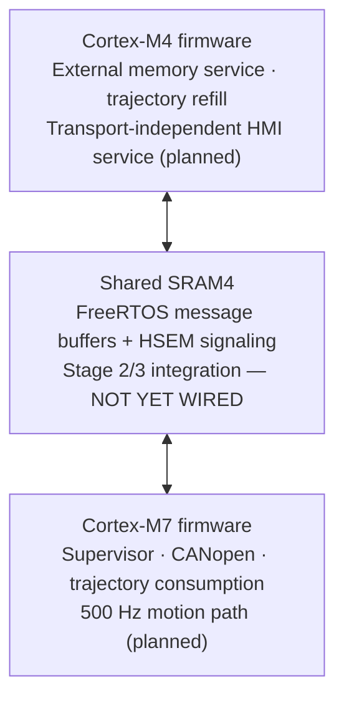

> Historical engineering record: the ZIT6 integration supersedes these build/staging instructions. See [current firmware instructions](README.md). The original evidence below is retained.

---
title: "Stage 1 — STM32H745 Dual-Core Firmware Foundation"
project: "GPRobotControl_Simulation"
branch: "sara/can-replacement"
stage: 1
status: "Verified — two baseline ELF builds; no hardware validation"
date: 2026-10-12
tags:
  - graduation-project
  - stm32h745
  - freertos
  - embedded-firmware
  - engineering-decision-record
---

# Stage 1 — STM32H745 Dual-Core Firmware Foundation

**Project:** 6-DoF Robot Controller · **Baseline recorded:** 12 October 2026  
**Result:** **COMPLETE at the firmware-foundation level** — STM32CubeMX-generated CM7 and CM4 images each compiled and linked without errors or warnings, both in the original CubeMX project and a fresh import of a repository-derived copy.

> [!IMPORTANT] Scope boundary
> This is a *firmware build foundation*, not a functioning dual-core robot controller. There was no STM32 hardware, no flashed execution, no wired peripheral, and no integration of the existing application IPC, CANopen control, trajectory handling, or external flash drivers into the generated ELFs. Passing independent builds does **not** prove inter-core communications, cache coherence, 500 Hz scheduling, boot robustness, or robot safety.

## 1. Objective and engineering context

The graduation-project controller is intended to use an **STM32H745 dual-core MCU**, separating time-sensitive motion/control responsibilities from supporting services. Earlier work established modular application code and software-only IPC tests in a WSL/Linux environment. Those tests did not contain a real STM32 image, startup files, linker memory map, HAL configuration, or per-core FreeRTOS firmware.

**Stage 1 objective:** establish a reproducible, vendor-generated embedded baseline with **two separately linkable executable targets**, one for Cortex-M7 and one for Cortex-M4, before connecting the robot application.

**Planned, not implemented, task allocation:**



**Design principle:** preserve the simulation architecture and its module interfaces; introduce only the target-platform infrastructure necessary to build the firmware. No application-facing UART/HMI protocol or pin mapping was chosen in this stage.

## 2. Authoritative source and resulting layout

**Generator:** standalone STM32CubeMX, with STM32CubeIDE used for building and debugging. The installed CubeIDE uses the workflow where a standalone CubeMX project is generated and then opened in CubeIDE. We selected the *MCU*, not a development-board template, because the final PCB is not finalized.

**Generated target:** `STM32H745IITx`, **LQFP176**. This is a *provisional package-level selection*. The precise procurement suffix/temperature grade and PCB pinout still require team confirmation. The CubeMX file records `STM32H745IITx` rather than a finalized orderable part.

**Software stack used by the generated project:**

| Component | Selected / observed | Why |
|---|---|---|
| ST firmware package | `STM32Cube FW_H7 V1.13.0` | Consistent vendor HAL/CMSIS/FreeRTOS source set; already installed |
| Configuration generator | STM32CubeMX | Central, regeneration-capable MCU/peripheral specification |
| Toolchain/project | STM32CubeIDE, GCC, C | Separate native STM32 builds and maintainable generated project metadata |
| RTOS middleware | FreeRTOS Kernel **10.6.2**, on both cores | ST-generated target-specific kernel and ARM ports |
| RTOS API selection | **CMSIS-RTOS V2**, both cores | Standard ST-generated task setup while permitting required native FreeRTOS IPC functions in future modules |
| Project structure | **Advanced**, **Generate Under Root** | Explicit CM7/CM4 projects with shared vendor components |
| Boot option | **Both CPUs booting at once** | Vendor-generated initial startup coordination; application IPC handshake still pending |

**Tracked source tree:**

```text
Firmware/
├── README.md                        # Firmware landing page
├── STAGE1_DUAL_CORE_FOUNDATION.md    # This engineering record
└── STM32H745/
    ├── GP_STM32H745.ioc             # Source of truth for generated MCU settings
    ├── .mxproject / .project
    ├── CM7/
    │   ├── .cproject / .project
    │   ├── Core/Inc/FreeRTOSConfig.h
    │   ├── Core/Src/main.c
    │   ├── Core/Src/stm32h7xx_hal_timebase_tim.c
    │   ├── Core/Startup/startup_stm32h745iitx.s
    │   ├── STM32H745IITX_FLASH.ld
    │   └── STM32H745IITX_RAM.ld
    ├── CM4/                         # Analogous independent image files
    ├── Common/                      # Generated dual-core system support
    ├── Drivers/                     # Version-matched CMSIS/HAL sources
    └── Middlewares/                 # Generated FreeRTOS/CMSIS-RTOS integration
```

The generated code lives *beside*, not inside, the WSL host simulator. **Neither top-level POSIX `FreeRTOSConfig.h` nor host-only CMake output is a firmware build source.**

## 3. Decisions, rationale, alternatives and trade-offs

### D1 — Generate hardware infrastructure with STM32CubeMX

**Decision:** let ST generate core startup, exception vectors, linker scripts, HAL initialization, FreeRTOS integration, and CubeIDE build metadata.

**Why:** H745 boot and dual-core peripheral ownership are device-specific. Standard vendor templates minimize handwritten register initialization and make settings traceable through the `.ioc` model. Regeneration allows future peripheral/pin changes without replacing the application architecture.

**Alternative rejected for Stage 1:** hand-authoring a full startup/interrupt/linker infrastructure or adapting the POSIX host project into a fake firmware ELF.

**Trade-off:** generated files and HAL/CMSIS/FreeRTOS vendors add repository size and must be changed carefully, preferably through CubeMX settings and designated `USER CODE` regions.

### D2 — Create two complete executable images, not one simulation executable

**Decision:** CM7 and CM4 have independent project metadata, startup assemblies, Flash/RAM linker scripts, FreeRTOS configuration files, and `.elf` targets.

**Why:** the cores differ in CPU architecture, vector tables, accessible memory, RTOS port, Flash image and scheduling context. A single host task scheduler cannot validate a two-image build. Separate compilation catches ARM target and core-specific dependencies early.

**Trade-off:** firmware and common middleware need coordinated versioning and two build results.

### D3 — Choose CMSIS-RTOS V2 with native FreeRTOS compatibility

**Decision:** enable `CMSIS_V2` for `FREERTOS_M7` and `FREERTOS_M4`, resulting in FreeRTOS **10.6.2** and CMSIS-RTOS2 wrappers in the generated project.

**Why:** it is a supported CubeMX generation mode, produces baseline tasks and portable service APIs, and keeps the firmware close to ST's intended integration. Our previously authored IPC uses **native FreeRTOS Message Buffer APIs**; the abstraction wrapper does not force us to rewrite that module.

**Important limitation:** coexistence is an architectural plan, **not** an IPC integration test. The earlier real FreeRTOS POSIX test and cross-compiles used a separate installed kernel; that testing must not be represented as a complete end-to-end test with the generated 10.6.2 target and its two separate schedulers.

### D4 — Enable static and dynamic allocation on each core

**Decision:** both target `FreeRTOSConfig.h` files contain:

```c
#define configSUPPORT_STATIC_ALLOCATION   1
#define configSUPPORT_DYNAMIC_ALLOCATION  1
```

**Why static:** the planned shared IPC Message Buffers require explicitly allocated descriptors/storage and a stable lifetime. This aids ownership and memory budgeting.

**Why dynamic remains enabled:** the generated CMSIS-RTOS V2 startup and `heap_4` allocator support ordinary OS object creation. Stage 1 is a minimal firmware baseline, not a policy that all runtime allocations are safe during motion.

**Trade-off:** dynamic allocation has potential fragmentation/failure and timing concerns. Later firmware work must allocate critical resources before motion is enabled and verify bounded memory behavior.

### D5 — Separate HAL tick from the FreeRTOS scheduler tick

**Decision:** **TIM6 for CM7 HAL timebase**, **TIM7 for CM4 HAL timebase**. FreeRTOS uses SysTick with `configTICK_RATE_HZ = 1000`.

**Why:** sharing SysTick between HAL delay/timebase functions and the RTOS scheduler creates priority and tick-management interactions. Separate TIM peripherals are CubeMX-supported for the two cores, and we resolved peripheral ownership in CubeMX before generation.

**Trade-off:** reserves two general-purpose timers and interrupts. The RTOS tick is **not** the planned deterministic 500 Hz control-loop clock; 1 ms kernel ticks do not prove a 2 ms motion deadline.

### D6 — Enable Newlib reentrancy on both FreeRTOS instances

**Decision:** both `FreeRTOSConfig.h` files contain:

```c
#define configUSE_NEWLIB_REENTRANT 1
```

**Why:** Newlib library operations can maintain per-task state (e.g., errno and other reentrant libc mechanisms). The option is recommended by CubeMX for generated FreeRTOS projects.

**Trade-off:** increases per-task RAM usage; it does not make *every* libc call deterministic or safe for the control loop, nor make dynamic memory allocation suitable for interrupt contexts.

### D7 — Start with vendor-generated MPU and conservative clocks

**Decision:** accept CubeMX's suggested Cortex-M7 MPU baseline. The generated M7 `main.c` initializes MPU region 0 with a broad guard/default-access policy; **there is no application-specific SRAM4 non-cacheable region yet**. The `.ioc` shows **64 MHz HSI-derived baseline CPU clocks** for both cores (not a tuned high-performance robot-control clock tree).

**Why:** a basic ST-generated MPU template avoids speculative access problems in portions of the memory map and provides a known starting point. Clock and MPU optimization should occur once actual shared-memory usage, electrical design and peripheral budgets are known.

**Trade-off:** neither MPU/cache coherency nor the intended 500 Hz control margin is established. Stage 2 must explicitly review SRAM4 attributes and whether/when caches are enabled.

### D8 — Use generated dual-core boot scaffolding without inventing an IPC handshake

**Decision:** leave CubeMX option **Both CPUs booting at once** and retain its ST-generated startup synchronization.

**Observed code:** CM4 enables an HSEM-0 notification and enters D2 STOP while CM7 initializes clocks; CM7 takes/releases HSEM 0 to wake CM4. This is *generated startup sequencing*, **not proof of a validated IPC initialization protocol**.

**Why:** using the reference flow is safer than ad hoc cross-core reset/start code.

**Stage 2/3 requirement:** shared mailbox memory must be initialized exactly once before either core reads it, startup failures must be detected, and startup HSEM ID 0 must remain reserved.

### D9 — Keep vendor sources alongside the tracked project

**Decision:** preserve the generated `Drivers/` and `Middlewares/` trees and the `.ioc`, including licenses, rather than depending on an untracked per-developer install at build time. Exclude `Debug/`, `Release/` and compilation products.

**Why:** a coherent, relocatable source snapshot avoids hidden absolute dependencies, captures the exact FreeRTOS/CMSIS/HAL combination and supports independent team builds.

**Trade-off:** source footprint was approximately **12 MB** in the repository copy, versus approximately **120 MB** including build output in the original Windows tree. Generated vendor updates should be reviewed deliberately.

### D10 — Postpone nonessential hardware commitments

**Decision:** no final UART/RS-485/physical HMI transport, CAN wiring, external flash pins, 500 Hz timer, FT sensor wiring or PCB pin assignment in this foundation.

**Why:** the hardware and communication interface choices were not final. Those decisions do not block the ability to generate, build and preserve the dual-core software foundation; guessing them would create unnecessary coupling and churn.

## 4. Actual generated runtime and memory configuration

| Property | CM7 | CM4 | Stage 1 interpretation |
|---|---|---|---|
| CPU | Cortex-M7 | Cortex-M4 | Independently linked targets |
| FreeRTOS version | 10.6.2 | 10.6.2 | Bundled with CubeMX target sources |
| API | CMSIS-RTOS V2 | CMSIS-RTOS V2 | Default generated tasks |
| Static / dynamic allocation | 1 / 1 | 1 / 1 | Both allocation paths permitted |
| Heap scheme | `heap_4` | `heap_4` | Current startup choice |
| `configTOTAL_HEAP_SIZE` | 15,360 bytes | 15,360 bytes | Provisional OS heaps, **not all available RAM** |
| `configUSE_NEWLIB_REENTRANT` | 1 | 1 | Per-task Newlib state |
| RTOS tick | 1000 Hz | 1000 Hz | Scheduling tick only |
| HAL timebase | TIM6 | TIM7 | Separate from scheduler tick |
| Initial CMSIS default task | 512-byte configured stack | 512-byte configured stack | Demo scaffolding; not production sizing |
| Linker Flash window | 0x08000000, 1024 KiB | 0x08100000, 1024 KiB | Separate Flash banks |
| Primary linker RAM | `RAM_D1` 0x24000000, 512 KiB | `RAM` 0x10000000, 288 KiB | Different default placements |
| Shared SRAM4 | M7 linker declares `RAM_D3` at 0x38000000, 64 KiB | Not declared as a region in current M4 Flash linker | **Not yet jointly reserved for IPC** |

**Careful distinction:** the linker minimum C runtime heap/stack symbols (`_Min_Heap_Size=0x200` and `_Min_Stack_Size=0x400`) are *not* the FreeRTOS `configTOTAL_HEAP_SIZE` and are *not* a complete thread-stack budget.

The compiled firmware is currently minimal, with CubeMX `defaultTask` scaffolding. No application code should infer available real-time CPU headroom or stack margins from these small baseline sizes.

## 5. Verification methodology and evidence

### 5.1 Original generated project — independent build

Project originally generated under:

```text
D:\University\Graduation Project\STM32\GP_STM32H745
```

Both CM7 and CM4 were built in STM32CubeIDE with **0 errors, 0 warnings**.

### 5.2 Repository-content reproduction

1. Copied generated firmware sources to WSL repository at `Firmware/STM32H745/`, excluding binaries and `Debug/Release` directories.
2. Reviewed tracked file set before commit; **169 source/configuration files**, **no staged `.elf`/`.o`/`.bin`/`.hex` or Debug/Release outputs**.
3. Committed baseline on `sara/can-replacement`, rebased onto prior documentation commit and pushed to GitHub.
4. Created a separate *verification* snapshot from the local repository content:

```bash
cd ~/freertos-pc-test
rsync -a Firmware/STM32H745/ \
  "/mnt/d/University/Graduation Project/STM32/GP_Repo_Verification/"
```

5. Opened a distinct STM32CubeIDE workspace (`GP_Verification_Workspace`), imported the parent + CM7 + CM4 projects via **Existing Projects into Workspace**, enabled nested project search and left **Copy projects into workspace** unchecked.
6. Rebuilt **each image** from the verification snapshot. Both succeeded with **0 errors, 0 warnings** and baseline size figures identical to the original build.

| Evidence | Cortex-M7 | Cortex-M4 |
|---|---:|---:|
| Target ELF | `GP_STM32H745_CM7.elf` | `GP_STM32H745_CM4.elf` |
| Original build errors / warnings | 0 / 0 | 0 / 0 |
| Repository-snapshot rebuild errors / warnings | **0 / 0** | **0 / 0** |
| `arm-none-eabi-size` .text | 19,884 B | 15,996 B |
| `arm-none-eabi-size` .data | 100 B | 100 B |
| `arm-none-eabi-size` .bss | 20,884 B | 20,884 B |
| Total (`dec` column) | 40,868 B | 36,980 B |
| Rebuild wall time (IDE reported) | 2.642 s | 2.393 s |

**Evidence origin:** operator-provided STM32CubeIDE console screenshots and WSL commands on 2026-10-12; no automated CI firmware build has yet been added. Compiler success means *compile and link succeeded*, not that the ELF executed on silicon. The `dec` size column is the sum of .text + .data + .bss in the tool report, not an exact Flash-image size.

### 5.3 Relation to earlier IPC tests

Separate from these firmware builds, the project previously verified:
- Cortex-M7/M4 cross-compilation of `ipc_mailbox_freertos.c` against an installed FreeRTOS checkout.
- A POSIX FreeRTOS Message Buffer runtime test (16-message capacity, nonblocking backpressure, callback behavior and 2,000 messages/direction).
- M7 and M4 HSEM adapter logic with test doubles.
- Compilation of the HSEM adapter with official STM32CubeH7 HAL headers and driver sources.

These are useful precursor tests; **none of those modules is yet wired into the generated CM7/CM4 application builds**, and POSIX scheduling does not model simultaneously executing cores.

## 6. Acceptance review

| Stage 1 criterion | Result | Evidence / condition |
|---|---|---|
| MCU type and package recorded | **PASS (provisional)** | `STM32H745IITx`, LQFP176; exact order code pending |
| Generator/source of truth preserved | **PASS** | `GP_STM32H745.ioc` |
| Two startup/vector and linker foundations | **PASS** | Separate CM7 and CM4 directories |
| Genuine per-core RTOS configs present | **PASS** | Generated `FreeRTOSConfig.h` files |
| Both targets compiled/linked | **PASS** | Original CubeIDE builds |
| Portability from repository sources | **PASS (one workstation)** | Separate repo-derived verification copy, imported and built twice |
| Vendor source/license preservation | **PASS** | Generated `Drivers` and `Middlewares` tracked |
| Hardware execution & flash | **NOT TESTED** | Hardware unavailable |
| IPC linked and operating between cores | **NOT IMPLEMENTED** | Future integration stage |
| Existing WSL simulation regressions post-import | **NOT RE-RUN** | No host sources intentionally changed by this stage |

**Stage 1 disposition: ACCEPTED** for its stated objective. **Do not mark the overall firmware or IPC integration as complete.**

## 7. Risks, constraints and open engineering actions

| ID | Risk or unresolved item | Consequence / required action |
|---|---|---|
| R1 | Shared SRAM4 not mapped in both applications | Design common, aligned, **NOLOAD** sections in both linker scripts; avoid dual initialization, stack collisions and alias assumptions |
| R2 | Cortex-M7 MPU template does not assign SRAM4 non-cacheable attributes | Design explicit MPU region, verify cache policy, barriers and access rights before shared-memory reads/writes |
| R3 | Boot HSEM 0 is used by generated startup | **Reserve ID 0 for boot**; IPC adapter currently defines **HSEM IDs 24–27** in `Intercore/ipc_stm32h745_hsem.h`; check whole-system reservations and ISR routing |
| R4 | IPC backend's `configUSE_STREAM_BUFFERS == 1` preprocessor requirement is absent as an explicit definition in both generated configs | Resolve with CubeMX-compatible per-core user-code configuration before compiling the IPC backend (verify actual FreeRTOS 10.6.2 support) |
| R5 | IPC POSIX/kernel-header tests used a separate FreeRTOS checkout; firmware vendor kernel is 10.6.2 | Verify exact ABI/layout and build the IPC backend against **the committed firmware kernel for both cores**; ensure identical message-control layouts |
| R6 | FreeRTOS Message Buffer control blocks cross independent kernels | Review semantics for truly independent schedulers, nonblocking mode, task wait handles and shared critical sections; host runtime test does not establish hardware-safe concurrency |
| R7 | 15,360-byte FreeRTOS heaps and 512-byte example stacks not sized for robot tasks | Perform task-by-task RAM sizing, stack high-water marks, initialization policy and worst-case allocation analysis |
| R8 | HSI-derived 64 MHz baseline clocks | Evaluate eventual control bandwidth, peripheral clocks, power and thermal limits; do not claim 500 Hz deadline adherence |
| R9 | Generated M4 linker primary RAM starts at 0x10000000, while SRAM4 is 0x38000000 | Introduce explicitly shared address-region mapping on both cores; do not mistake current M4 RAM for SRAM4 |
| R10 | Final MCU package, physical HMI transport, CAN pins and SPI/QSPI hardware are undecided | Preserve abstraction layers; select later against the actual board/electrical design |
| R11 | No physical power-on, dual-ELF flashing, MPU or IRQ validation | Must test on actual MCU before field use |
| R12 | STM32CubeMX regeneration can overwrite direct generated-file edits | Change peripheral/system settings through `.ioc`; place project-owned code in user sections or independent modules; review regeneration diffs |

**Engineering caution:** The current HSEM adapter's 24–27 ID reservation avoids the *identified* boot-HSEM-0 collision in source code, but we have not demonstrated complete IRQ integration or guaranteed exclusivity against all future peripherals.

## 8. Stage 2 handoff — Shared SRAM4 memory map and MPU

**Start from the committed generator output.** Do not create a replacement startup sequence or hand-edit ST peripheral registers.

**Stage 2 objective:** define and enforce a common, measured address/layout contract for all cross-core IPC and trajectory metadata/storage while preserving both independent firmware builds.

Proposed sequence (subject to measured sizes and hardware-memory-map review):

1. **Inventory:** extract SRAM4 region, existing linker allocations, `GpIpcShared` size/alignment, trajectory descriptor/buffer sizes, and any overlapping reserved memory.
2. **Layout contract:** decide owners, bounds, capacity, ABI/version, alignment, reset semantics and `NOLOAD` behavior for the shared region.
3. **Linker integration:** add/verify consistent named sections and symbols in CM7 and CM4 Flash-linker maps; reject overflow and overlap at link time.
4. **M7 MPU:** configure the shared SRAM4 region as normal, non-cacheable, shareable memory per STM32H7/Cortex-M7 requirements; consider memory attributes of adjacent regions and do not silently disable all caching as a workaround.
5. **Init/boot contract:** keep the generated boot semaphore handshake distinct from IPC HSEMs; define one initializer, a ready/ABI handshake, barriers and reset recovery.
6. **Build and inspect:** compile/link **both** images from repository-controlled sources; use `arm-none-eabi-nm`, `readelf` and linker map evidence for identical placement and adequate margins.
7. **Keep limits explicit:** software builds can verify addresses and object footprints, but not physical cache coherence or actual inter-core data visibility.

**Initial Stage 2 question:** before modifying linker scripts, what exact shared-memory objects already exist, what are their `sizeof`/alignment under the pinned target compiler and FreeRTOS 10.6.2 headers, and can they fit within the STM32H745 SRAM4 budget (64 KiB) without overlap?

## 9. Sources and traceability

**Repository sources:**
- [CubeMX project](STM32H745/GP_STM32H745.ioc)
- [CM7 FreeRTOSConfig](STM32H745/CM7/Core/Inc/FreeRTOSConfig.h) / [CM4 FreeRTOSConfig](STM32H745/CM4/Core/Inc/FreeRTOSConfig.h)
- [CM7 startup](STM32H745/CM7/Core/Src/main.c) / [CM4 startup](STM32H745/CM4/Core/Src/main.c)
- [CM7 linker](STM32H745/CM7/STM32H745IITX_FLASH.ld) / [CM4 linker](STM32H745/CM4/STM32H745IITX_FLASH.ld)
- [Project HSEM adapter](../Intercore/ipc_stm32h745_hsem.c) and [reservation header](../Intercore/ipc_stm32h745_hsem.h)
- [Inter-core integration contract](../Intercore/README.md)

**Official reference material:**
- [ST AN5361 — Getting started with projects based on dual-core STM32H7 MCUs in STM32CubeIDE](https://www.st.com/resource/en/application_note/an5361-getting-started-with-projects-based-on-dualcore-stm32h7-microcontrollers-in-stm32cubeide-stmicroelectronics.pdf)
- [STM32CubeH7 official source package](https://github.com/STMicroelectronics/STM32CubeH7)
- [FreeRTOS Message Buffer API](https://www.freertos.org/Documentation/02-Kernel/04-API-references/08-Stream-buffers/02-Message-buffers)

---

**Final review:** Stage 1 established the *buildable dual-core platform baseline*. Stage 2 is the *memory/MPU contract*. The next stages are *IPC startup/integration, application wiring, timing verification and real hardware bring-up*. Keep these claims separate in presentations and reports.
