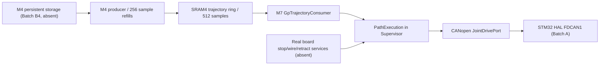

> Historical engineering record: the ZIT6 integration supersedes these build/staging instructions. See [current firmware instructions](README.md). The original evidence below is retained.

# Stage 3 Batch B1 — M7 Motion Composition

**Source integration:** `aa8628a` (2026-10-14). **Software acceptance:** PASS, operator-reported 2026-10-14; see `STAGE3_BATCH_B1_ACCEPTANCE.md`.

## Ownership and data flow



The existing `PathExecution` owns sample deadlines, missed-period skip/expiry, feedback freshness and joint-drive command requests. It uses `canopen_joint_drive_port_make()` in the M7 Supervisor; no new CANopen master or motor task is introduced. `GpTrajectoryExecutionBinding` is a persistent, M7-private structure supplied to `PathExecutionServices`.

## B1 implementation

- The M7 composition calls `gp_traj_execution_bind` on the **already initialized** Stage 2 trajectory SRAM4 partition, before starting Supervisor.
- The adapter forwards physical wire-feed, retraction, clearance and controlled-stop callbacks to the original board context; it supplies only `read_sample`, `skip_samples`, `stream_ready` and `end_stream`.
- A board trying to supply a second stream provider, or lacking any physical non-stream callback, is rejected **before motion can be enabled**.
- Stream preflight uses the immutable validated-artifact program ID, revision, artifact CRC, sample count and 2000-us period. It refuses an unprepared, stale, mismatched or insufficiently buffered epoch.
- Reads/skips recheck the metadata, refuse expired ownership and do not block to refill from flash. Paused paths retain M7 stream ownership; exiting paths release or discard the M4 producer epoch.
- The existing runtime failure path now makes one best-effort controlled-hold request on following-error, lost motion permission and communication faults during trajectory following, after commanding wire feed OFF; this is neither verified deceleration nor certified protective stopping. Host fault tests assert exactly one request, no new target commands and a latched failure.
- No real board supplier exists; Batch B1 **does not** commission drives, fabricate F/T or safety signals or fabricate a durable M4 trajectory.

## Acceptance: one local command after staging and clean CubeIDE builds

```bash
cd ~/freertos-pc-test
git pull --ff-only origin sara/can-replacement
bash Firmware/Tests/stage_stage3_batch_b1.sh "/mnt/d/University/Graduation Project/STM32/GP_Stage3_Repro"
# Clean-build Cortex-M7 AND Cortex-M4 independently using CubeIDE.
bash Firmware/Tests/check_stage3_batch_b1_acceptance.sh "/mnt/d/University/Graduation Project/STM32/GP_Stage3_Repro"
```

The gate checks canonical staging parity, ARM object compilation, host trajectory/PathExecution fault and CANopen tests, target image freshness, strong retained M7 binding symbols and Batch A symbols. Source changes are not a substitute for passed test output.

## Hardware and dependent software gates

- B3/B4 must provide validated M4 storage and new prepared stream epochs. A stream without a commissioned M4 producer is **not ready**.
- The actual board provider must supply physical CANopen node identity, scale, safety and stop/retraction services. Software hold/controlled-stop callbacks are not a substitute for independent safety hardware.
- Physical scope/logic-analyzer tests must quantify 500 Hz jitter, budget, bus load and reaction to stale/error TPDO, bus-off and power loss.

## STM32CubeIDE header-path correction (2026-10-14)

The first operator CM7 build failed at `application_supervisor.c:16` with
`fatal error: trajectory_stream_path_port.h: No such file or directory`.
This was caused by the new header being staged at `CM7/Application/Intercore`
without an associated project include-path entry. It is **not** evidence that
the trajectory/CANopen implementation failed.

The authoritative `CM7/.cproject` now includes
`../Application/Intercore` in the Debug and Release assembler/compiler
include path options. The B1 staging script adds only these four include-path
entries to the independent verifier's `.cproject` without replacing
unrelated CubeIDE settings; the acceptance test validates all four entries
before reading any ELF. Do not manually duplicate `Intercore` headers into
`Core/Inc` or alter CubeMX-managed HAL peripheral configuration.

**Accepted:** operator confirmed successful CM7 and CM4 target builds and supplied the complete successful B1 consolidated test output. See `STAGE3_BATCH_B1_ACCEPTANCE.md`; physical commissioning remains deferred.
