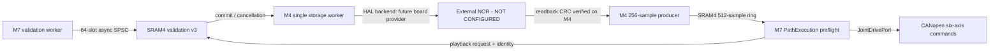

# Stage 3 — Batch B4 NOR Reader and Trajectory Producer

**Date:** 2026-10-14. **Branch:** `sara/can-replacement`.  
**Status:** implementation committed; independent WSL/CubeIDE acceptance pending.

## Execution architecture



The M4 validation task serializes asynchronous validation commits and
post-commit playback reads. It never runs NOR I/O in the M7 control cycle.

The M7 path service publishes an immutable playback identity in SRAM4
and waits nonblockingly at Supervisor ticks. The **physical board must
provide an explicit `prefill_timeout_ms`**; zero stays fail-fast.
Until the full artifact's sample bytes pass CRC32 readback, the M4
producer does not publish an epoch. After verification it reuses
`gp_traj_m4_prepare` and one `gp_traj_m4_step` per worker cycle, with
at most 256 samples per read and 512 samples of prefill before M7 motion.
Failed reads/corrupt CRC never publish a valid new trajectory.

## Board-dependent commissioning remains CLOSED

Both physically reviewed supplier functions are needed before M4 starts
the combined storage worker:

- `gp_board_m4_supply_validation_backend`: durable begin/write/commit/abort;
  `commit` must verify persistence and survive the defined reset model.
- `gp_board_m4_supply_trajectory_reader`: immutable committed metadata
  and sample readback from the SAME hardware artifact, in 256-sample batches.

Neither is currently defined. This code does not initialize any QUADSPI,
OCTOSPI, nor GPIO; those MUST be STM32CubeMX/HAL-managed after selecting
the flash part, wiring, voltage/clock and verifying the vendor datasheet.
Do not provide a RAM/mock implementation in the firmware.

Host tests with a test-only fake flash cover committed-to-replay,
identity, corruption, failed read and in-flight cancel. These are **not**
physical NOR timing, persistence or power-loss tests. The M4 storage
worker's 768-word stack is provisional; Stage C must measure its actual
watermark and per-memory-bank budget. Independent core restarts remain
an unsupported condition until a supervised quiescent reset policy is
implemented and physically verified.

## One acceptance workflow

```bash
cd ~/freertos-pc-test
git pull --ff-only origin sara/can-replacement
bash Firmware/Tests/stage_stage3_batch_b4.sh \
  "/mnt/d/University/Graduation Project/STM32/GP_Stage3_Repro"
# Refresh / CLEAN-BUILD both CM7 and CM4 projects in STM32CubeIDE.
bash Firmware/Tests/check_stage3_batch_b4_acceptance.sh \
  "/mnt/d/University/Graduation Project/STM32/GP_Stage3_Repro"
```

B4 can only be marked **software accepted** after the operator supplies
the final PASS and clean target-build evidence. Do not claim working
hardware until the commissioning gates are separately executed.
