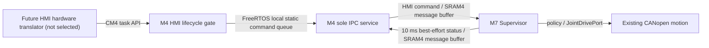

# Stage 3 Batch B5 — HMI lifecycle and consolidated software qualification

**Source status (2026-10-14):** B5 committed; operator CubeIDE and WSL acceptance **pending**. B1–B4 were previously accepted at their declared software gates.

## Scope

- Reuse the existing ST FreeRTOS 10.6.2 **M4 static queue plus M4↔M7 message-buffer IPC**. Only the existing M4 `defaultTask` reads controller status/sends HMI commands. No new cross-core scheduler, semaphore or HAL implementation.
- B5 `Intercore/hmi_lifecycle.{h,c}` validates the existing seven-word M7 status ABI and sequence monotonicity, including counter rollover and invalid robot state/bool fields.
- CM4 submits HMI events only with fresh M7 telemetry (100 ms local M4 tick threshold) and a valid command. It drops buffered events on status loss, state transitions, new faults or E-stop and rechecks the command immediately before sending to M7. A stable FAULT status can still submit RESET/HOME to M7 for independent policy evaluation; an asserted E-stop cannot.
- M7 continues to arbitrate all state transitions and drive permission; M4 telemetry is advisory and neither receipt acknowledgement nor motion authorization.
- M7 limits consumption of queued teaching commands to the existing single pending teaching-event slot; no silently overwritten RECORD event within one Supervisor cycle.
- Physical display/panel protocol is **not** selected. The existing `application_ipc_service_submit_hmi` and `application_ipc_service_read_status` are the supported application port. No UART/CAN/Ethernet hardware transport is invented.

## Architecture



## Acceptance

```bash
cd ~/freertos-pc-test
git pull --ff-only origin sara/can-replacement
bash Firmware/Tests/stage_stage3_batch_b5.sh \
  "/mnt/d/University/Graduation Project/STM32/GP_Stage3_Repro"
# Refresh and CLEAN-BUILD both CM7 and CM4 in STM32CubeIDE.
bash Firmware/Tests/check_stage3_batch_b5_acceptance.sh \
  "/mnt/d/University/Graduation Project/STM32/GP_Stage3_Repro"
```

The script compiles/executes the new host HMI state/sequence/fault tests,
reruns all B1–B4 established gates, then verifies M4 HMI and M7 Supervisor
symbols retained in independently linked Debug target ELFs. It remains
software/host/ARM/ELF qualification only; core restart policy, powered
STM32 timing, NOR, physical HMI and certified robot safety are Stage C/
commissioning gates.

**Do not mark B5 accepted until the operator supplies the full script PASS
and independent target builds.**

## Linker-garbage-collection scope

The full CubeIDE Debug linker may eliminate `supervisor_task_post_hmi`
(M7 local optional command injection) and
`application_ipc_service_submit_hmi` (future M4 physical display adapter)
because neither is reachable from the currently commissioned production
call graph. Both remain source/ARM compile API requirements but must **not**
be required as strong target-ELF symbols before hardware UI selection.
B5's ELF gate tests reachable M7/M4 IPC receivers, status policy and
service task symbols instead. Do not defeat `--gc-sections` using
`KEEP` solely to satisfy a test.
