# Stage 4 — Cartesian Hand-Guiding Architecture and Acceptance

**Status:** pre-hardware, software-only. **Motion permission:** NOT RELEASED.
**Baseline:** `sara/can-replacement`, Stage 3 software candidate.
**Scientific reference:** Keemink, van der Kooij & Stienen (2018), *Admittance control for physical human–robot interaction*, DOI 10.1177/0278364918768950. Sections 5–7 discuss virtual dynamics, damping, measurement phase lag and interaction stability.

## 1. Architecture and ownership

```mermaid
flowchart LR
    S["F/T sample (sensor frame)"] --> P["Validation, tare, wrench transform"]
    P --> A["6-axis virtual mass-damper"]
    A --> K["ControlCore Jacobian and bounded joint references"]
    K --> M["M7 Supervisor: exclusive motor command authority"]
    M --> D["JointDrive / CANopen / six drives"]
    D --> F["Measured joint feedback"]
    F --> T["TEACHING point recording and FK"]
```



The arrows after F/T processing describe the **planned** integration; they are not wired to the firmware. The TEACHING state already uses drive feedback and FK to record taught points. `SUPERVISOR_MESSAGE_GUIDED_TARGET` currently carries raw position counts, but must not be treated as a validated admittance command path. The M7 Supervisor must remain the only producer of motor commands; the M4 is not assigned that authority.

## 2. Frame convention and measured load path

- **S**: F/T sensor's measurement frame, with its torque reported about S's origin.
- **F**: robot flange frame.
- **G**: operator grip frame, attached beyond the external F/T sensor.
- **TCP**: configured tool control point, generally different from F and G.
- `flange_T_sensor`: pose of S in F. Its quaternion is `[w,x,y,z]`, rotation `R_F_S` and translation `p_F_S` expressed in F, metres.
- `sensor_T_grip`: pose of grip in S, useful for mechanical verification. Do **not** add its lever arm to the measured torque again.

For a bias-corrected sensor reading at S, the equivalent wrench at flange origin, expressed in F, is:

```text
f_F   = R_F_S * (f_S - b_f)
tau_F = R_F_S * (tau_S - b_tau) + p_F_S x f_F
```

For example, if the handle creates a moment through its own lever arm, the sensor already measures that moment. The extra cross product above transports the wrench **from sensor origin to flange origin**, not from grip to sensor. Wrench transformation to the **base-frame TCP reference** required for `control_jacobian()` is now implemented as a separate, still-unintegrated Batch 4B2 module. The Jacobian expects `[v_B, omega_B]` at TCP in base frame, so both frame and moment reference point must match the motion-control convention.

`g_sensor_config.geometry_verified=false`, with deliberately invalid zero quaternions, blocks physical use. Test fixtures with `geometry_verified=true` are synthetic and do not authorize robot movement.

## 3. Batch 4B1 — Validated sensor-to-flange wrench

Updated existing `ft_sensor.c/.h` without introducing a new processing framework:

1. `ft_sensor_sample_usable()`: maintains finite-value, acquisition-validity and bounded timestamp-age checks. The caller must supply timestamps from the same monotonic microsecond clock, with unambiguous elapsed age.
2. `ft_sensor_capture_bias()`: records a **static** six-channel offset from a fresh sample and invalidates the bias if capture fails. Calibration is a separate procedure; a single reading is a provisional zero, not statistically validated sensor calibration.
3. `ft_sensor_wrench_in_flange()`: zero-initializes output; rejects invalid sensor data, geometry and bias; subtracts bias; rotates force and torque; applies the point-shift cross product; rejects nonfinite results.

No sensor protocol, filter, online tare trigger, motion output or motor transport is added in this batch. Tare should be authorized only under confirmed unloaded/quiescent conditions. Taring under applied human force would misclassify that force as bias. A static tare cannot compensate orientation-varying post-sensor handle weight, inertia or temperature drift. Real compensation depends on load-path CAD, masses, centre of mass, sensor orientation and commissioning evidence.

**Safety limitation:** On failure the function returns `false` and clears its output. The future controller must latch/inhibit guidance and perform the defined safe stop; it must **not** simply interpret a fault as an intentional zero-force release. Software fault responses are not independent hardware E-stop/STO.

## 4. Admittance numerical core (Batch 4C accepted in isolated host testing)

For each of six independent axes:

```text
M_i * dV_i/dt + D_i * V_i = W_i
V_next = (M_i * V_previous + dt * W_i) / (M_i + dt * D_i)
```

Axes 0–2: mass kg, damping N*s/m, force N, velocity m/s.
Axes 3–5: rotational inertia kg*m^2, damping N*m*s/rad, torque N*m, angular velocity rad/s.
The module validates positive masses, damping, velocity and acceleration limits and a caller-defined maximum step duration. It checks finite inputs and bounds per-axis velocity and acceleration. Explicit enable starts from zero virtual velocity; disable/reset and any invalid step clear and disable the controller. This is not a robot stop command. `K=0`: a released handle produces exponentially decaying commanded velocity, not a spring return-to-pose.

The parameters currently have **no approved physical tuning values**. Keemink et al. analyze largely single-DOF systems with velocity inner loops. Their coupled stability/passivity conditions cannot simply be asserted for this six-axis, position-commanded arm. Filtering is deferred pending sensor latency and noise measurements.

## 5. Kinematics and firmware integration (not yet accepted)

- Reuse `control_fk()`, `control_jacobian()`, `singularity_sigma_min()`, and established position-unit conversions.
- Existing `adls_ik()` is an iterative pose solver with large history storage; do not place it unmodified in the 2 ms path.
- Constrain `q`, `qdot`, workspace and valid acceleration bounds; initialize references from measured feedback; preserve continuous orientation handling.
- M7 Supervisor must verify authorization, fresh feedback, sensor validity and command limits **every cycle** before sending bounded joint targets. Do not create a competing command source.
- The current `RobotConfig` is a UR5 reference model, not certified custom-arm DH geometry. No physical-motion acceptance on the reference configuration.
- Stage 3 hardware handoff requirements remain open: CAN latency, MCU timing, electrical stops, drive feedback and real sensor wiring.

## 6. Batch 4B1 test and acceptance record

| Evidence | Command / finding | Status |
|---|---|---|
| Standalone configure | `cmake -S HandGuiding -B /tmp/gp-stage4-build` | PASS in isolated prepared snapshot |
| Build with diagnostics | `cmake --build /tmp/gp-stage4-build -j2` | PASS in isolated prepared snapshot |
| Focused CTest | `ctest --test-dir /tmp/gp-stage4-build --output-on-failure` | 3/3 PASS in isolated prepared snapshot |
| New wrench test | 90° rotation, torque shift, tare, stale data, invalid geometry and invalid bias | PASS in isolated prepared snapshot |
| Root integration | `cmake -S . -B <existing-host-build-dir>` and relevant `ctest` | NOT RUN; parent FreeRTOS/raylib dependencies are external |
| STM32 target integration | CM7/CM4 firmware build | NOT RUN |
| Physical interaction | E-stop/STO, drive tracking and stability | BLOCKED; no commissioned hardware |

**Important:** Isolated tests use the reviewed module code in a standalone local test copy; passing them is not equivalent to running the whole GitHub repository, SIL Kit simulation or the STM32 application. No real robot timing or physical safety assertion is made.

## 7. Remaining batches

| Batch | Acceptance deliverable |
|---|---|
| 4B2 | Base/TCP wrench conversion implemented and locally checked with a synthetic FK fixture; full checkout and hardware validation pending |
| 4C | Completed standalone lifecycle, per-axis acceleration limits, analytical step/release/rotation tests |
| 4D | Standalone Jacobian/DLS mapping to bounded joint references and targeted host tests; physical integration still pending |
| 4E1 | Composed sensor → admittance → joint mapper, standalone software-only. Tests pending final checkout |\n| 4E2 | Supervisor-owned guidance authorization, feedback and command lifecycle |\n| 4E3 | Integrated fault and timing tests |
| 4F | Reproducible SIL Kit end-to-end checks, regressions, firmware cross-compilation and hardware gate ledger |

## 8. Changelog

- **2026-10-17 — 4C:** Added explicit enable/disable lifecycle, six-axis acceleration bounding and caller-configured maximum step; verified analytical force/release/rotation and invalid-input tests in isolated host build. No Supervisor integration or physical motion.\n- **2026-10-17 — 4B1:** Audited initial eight-file hand-guiding code; added standalone build/test registration and sensor-to-flange wrench conversion, static tare, failure checks and focused unit test. Robot motion remains disabled.

## 9. Batch 4C — Numerical contract and acceptance record

The diagonal virtual mass-damper integration for each Cartesian axis is:

```text
v_model[k+1] = (M_i*v[k] + dt*W_i[k]) / (M_i + dt*D_i)
dv           = clamp(v_model[k+1] - v[k], -a_limit_i*dt, +a_limit_i*dt)
v[k+1]       = clamp(v[k] + dv, -speed_limit_i, +speed_limit_i)
```

This is backward Euler **before** bounds; acceleration and speed clipping change the ideal virtual dynamics. It does not establish physical robot acceleration or interaction stability: Jacobian conversion, servo tracking, encoder feedback and physical loop dynamics are not yet included.

- `admittance_enable(state, params)` validates all configured fields, clears prior virtual velocity and enables the controller. Invalid configuration leaves it disabled.
- `admittance_disable` and `admittance_reset` clear virtual velocity and disable.
- `admittance_step` requires an enabled controller, independently validated six-axis wrench in the same fixed frame/control point, and `0 < dt <= maximum_step_s`. It rejects nonfinite data, invalid parameters or unbounded state. On error it clears the output, resets and disables; later callers must treat this as a *fault* rather than interpreting it as handle release.
- `maximum_step_s` is a **required** timing-fault setting. The unit test's 0.004 s is only a synthetic fixture, not an approved MCU deadline or system requirement.
- All mass, damping, speed and acceleration limits must be explicitly tuned/approved from actual hardware behavior. No physical values are asserted. The controlled wrench reference must be finalized in 4B2/4D.
- No per-step heap allocation or unbounded search. Runtime verification on the MCU is pending. The returned twist does not itself authorize any motor commands.
- The API requires `twist_out` to have no storage overlap with either wrench input or state.

| Evidence | Test/command | Result |
|---|---|---|
| Standalone host configure | `cmake -S HandGuiding -B /tmp/gp-stage4-build -DCMAKE_BUILD_TYPE=Debug` | PASS in isolated local source copy |
| Standalone host compile | `cmake --build /tmp/gp-stage4-build -j2` | PASS in isolated local source copy |
| Unit tests | `ctest --test-dir /tmp/gp-stage4-build --output-on-failure` | **4/4 PASS** in isolated local source copy |
| Numerics | Six-axis independent reference values, analytical backward-Euler release, rotational response, signed acceleration and speed saturation | PASS |
| Fault and lifecycle | Disabled controller, reset, invalid configuration/input/state, nonfinite or late time step, no partial state commit | PASS |
| Full root CMake / SIL Kit / ARM firmware | Existing repository integrations | NOT RUN for 4C |
| Real servo + F/T sensor | Human–robot interaction and coupled stability | BLOCKED pending hardware and safety qualification |

**Validation distinction:** the local isolated source-copy test was performed before publishing this batch. Running the commands above in WSL after pulling the new commit is still necessary to verify the final GitHub checkout.

## 10. Batch 4D — Cartesian-to-joint reference generation (software-only)

**Files:** `cartesian_joint_mapper.h/.c`, `Tests/test_cartesian_joint_mapper.c`, `CMakeLists.txt`.
**Inputs:** fresh measured six joint angles in radians; externally authorized
TCP twist `[vx,vy,vz,wx,wy,wz]` expressed in the **base** frame. The
sensor-to-base/TCP wrench conversion is NOT completed by this batch.

Existing `control_jacobian(robot, measured_q, J)` gives the TCP Jacobian.
The module calculates `sigma_min(J)` via the reusable ControlCore analysis.
It rejects if `sigma_min < minimum_sigma`. Otherwise it uses the existing
`matrix6_solve()` on:

```text
(JᵀJ + λ²I) qdot_desired = Jᵀ twist_B_TCP
qdot_cmd_i = acceleration_limit(qdot_desired_i, qdot_previous_i)
qref_next_i = qref_previous_i + dt * qdot_cmd_i
```

Velocity clamping to `robot.limits.qdMax` precedes acceleration limiting.
The output's `limited` flag records any clamp. Because limiting is per-joint,
the resulting TCP direction can differ from the request; do not claim exact
Cartesian tracking or passivity. Positive DLS damping also introduces residual
tracking error. Mixed linear/angular Jacobian units make `sigma_min` and
`λ` geometry and scaling dependent; **no numeric production values** are set.

- **Initialization:** `enable()` copies *measured* joint angles into the
  six position references and clears velocity history. It checks finite
  robot DH parameters, joint limits, TCP homogeneous-transform bottom row and
  explicit `model_verified=true` gate; synthetic fixture approval is test-only.
- **Configuration:** positive `damping_lambda`, `minimum_sigma`,
  `maximum_step_s`, per-joint acceleration and feedback-tracking limits are
  required. The UR5 reference model has no `qddMax`; Batch 4D does **not**
  invent motor acceleration limits. If `qddMaxDefined`, the supplied
  accelerations must not exceed the model's entries.
- **Stateful step:** feedback position is used to compute the Jacobian;
  a separate reference position is integrated. Check feedback/reference
  tracking error before and after the step to prevent drift.
- **Hard faults:** singularity margin violation, nonfinite values,
  missed cycle threshold, feedback divergence or a target outside hard
  position bounds **rejects and disables the entire mapper**.
  A zeroed/invalid output is NOT a safe-stop/hold motion command.
- **Ownership:** zero FreeRTOS/CAN calls, heap allocation or 1000-iteration IK.
  Supervisor is still the only authorized drive owner. No actual custom-arm
  geometry, tool calibration, hardware limits, encoder scales or ST MCU runtime
  qualification is asserted.
- **Tests:** zero twist, fresh measured initialization, DLS reference,
  joint speed/acceleration limits and reversal, hard joint stop, synthetic
  singularity margin, tracking/timing/NaN/invalid-model faults.

Run after pulling:
```bash
cmake -S HandGuiding -B /tmp/gp-stage4-build
cmake --build /tmp/gp-stage4-build -j2
ctest --test-dir /tmp/gp-stage4-build --output-on-failure
```

Expected test inventory is 5; **verification is pending** until the committed
sources run in the user's checkout and/or CI. Do not label full robot
simulation, target-firmware execution, hardware motion or 500 Hz timing PASS.


## 11. Batch 4B2 — Sensor wrench at the TCP, in robot-base coordinates

**Implemented:** `wrench_frame_sensor_to_base_tcp()` in
`wrench_frame.c/.h` with `test_wrench_frame.c`. This stage only transforms
measured wrench data; it does **not** authorize motion or call CANopen.

### Frame meaning and sign convention

- `B` = robot base frame, `F` = flange origin, `S` = F/T sensor origin,
  `TCP` = configured tool control point.
- Reuse Stage 4B1 for bias, `S → F` rotation and moment shift.
- Reuse **existing** `control_fk(robot, measured_q, T_B_TCP)` from ControlCore.
- The tool definition is `T_F_TCP`. Recover the flange rotation:
  `R_B_F = R_B_TCP * R_F_TCP^T`.
- Move torque reference **from flange origin to TCP origin** before expressing
  the wrench in base coordinates:

```text
 f_B_TCP   = R_B_F * f_F
 tau_F_TCP = tau_F - p_F_TCP x f_F
 tau_B_TCP = R_B_F * tau_F_TCP
```

The subtraction is intentional: the origin moves from F to TCP. This is a
rigid-body wrench reference-point transform, preserving wrench/twist power
when both refer to the same point and coordinate basis. The mounted handle's
grip-to-sensor force lever arm is *already in the sensor torque channel*;
never add `p_S_G x f` again.

### Mandatory input contract

The caller supplies one **fresh, complete** six-axis acquisition sample with
a monotonic timestamp and valid flag, a valid static tare, sensor geometry
(`geometry_verified=true`), measured joint angles from the same physical
robot state, calibrated `T_F_TCP`, robot DH parameters and a separately
verified robot-model gate. Failures zero output and return false; consuming
code must **inhibit guidance** and use the independent safety-chain policy,
not interpret zeros as an intentional release of the handle.

The numerical model checks finite joint angles and geometry, joint ranges,
a homogeneous tool transform with orthonormal right-handed rotation, and
finite forward-kinematics output. The synthetic test config sets the
verification gates only to exercise the mathematics, not to approve hardware.

**Acquisition interface:** the existing `FtSensorSample` is protocol-neutral;
RS-485/Modbus frame parsing, CRC, per-frame integrity and sensor overload
must be checked by a future *vendor-specific input adapter* **before**
setting `sample.valid=true`. Complete-sample timestamps must come from one
monotonic MCU clock. Reject stale, missing, repeated-as-fresh, malformed,
CRC-bad or overloaded measurements at the acquisition/control boundary.

**Gravity and tool-load limitation:** `ft_sensor_capture_bias()` captures a
static offset under an explicitly unloaded pose. It does **not** perform
gravity compensation for mass downstream of the sensor, inertial compensation,
thermal calibration or drift correction. With a moving handle, gravity of
any post-sensor structure rotates into sensor coordinates and a one-pose
tare cannot remove it. Do not enable physical admittance until CAD load
paths, mass/CoM measurements, hand-force convention and compensation
acceptance tests are confirmed. There is no direct sensor-specification
claim or assumed F/T sample rate in this batch.

### Test coverage / evidence

The new `test_wrench_frame.c` exercises a synthetic all-zero-DH chain,
a 90-degree rotated **tool frame**, a rotated **sensor frame**, nonzero
sensor and TCP lever arms, calibrated tare, changes of measured joint
angle and sign checks for torque shifting. It rejects unverified geometry,
unverified model, stale F/T measurement, nonfinite/out-of-range joint angles,
reflection `det(R)=-1`, wrong DOF and invalid sensor measurements.

An isolated local **synthetic FK-stub** compile using
`gcc -std=c11 -Wall -Wextra -Werror -Wpedantic` passed this single
new unit-test fixture. **This is not a compile using the repository's
actual FK implementation.** The committed source **must** be verified
via strict standalone WSL CMake/CTest (expected six tests); CI/full
repository and real STM32 firmware verification are separate.

Batch 4E remains unstarted: it must integrate acquisition, F/T mapping,
admittance, joint reference generation and M7 Supervisor authorization,
including per-cycle live feedback, queue/command freshness, fault latching,
safe stop and encoder conversion. No real hardware enabling before
Stage 3 commissioning gates.


## 12. Batch 4E1 — Software-only hand-guiding composition (2026-10-17)

**Added:** `hand_guiding_pipeline.c/.h`, `Tests/test_hand_guiding_pipeline.c`, CMake test registration.

This single module **orchestrates** rather than reimplements the existing
mathematics. In every valid step:

```text
Live FtSensorSample + verified T_F_S + tare + RobotConfig + joint feedback
  -> wrench_frame_sensor_to_base_tcp()        # 4B1 + 4B2
  -> admittance_step()                        # 4C
  -> cartesian_joint_mapper_step()            # 4D, uses ControlCore Jacobian
  -> [valid, wrench_B_TCP, twist_B_TCP, six joint references in radians]
```

**Crucial:** This module has zero CANopen, FreeRTOS, Supervisor, encoder
conversion or actuator API calls. It neither starts nor stops hardware.
The returned joint references are *data*, not authorized commands.

**Lifecycle:** `reset()` explicitly clears the fault latch and all state
(must only be invoked by an externally authorized recovery procedure).
`arm()` checks external TEACHING/motion/homing/drive/feedback gates,
geometry/robot-model verification flags, tare, a live F/T sample, and
measured joint positions. It freezes the configuration and seeds joint
references from measured angles, **without producing any output target**.
`step()` checks the gates again, optionally requires a strictly newer
sensor timestamp, and computes all three stages. `stop()` disengages
without clearing an existing fault latch.

**Fault policy:** Any failed active step—including sensor staleness,
missing feedback, revoked motion permission, missed cycle, singularity
rejection or tracking-error failure—zeros output, disables *both*
controllers, and latches a fault. An invalid/zero output must **never**
be interpreted as a hold-position instruction or transmitted to motors.
No automatic re-arming is possible without explicitly calling `reset()`.
This software latch is not a hardware protective stop, STO or E-stop.

**External-gate semantics:** `teaching_active`, `motion_permitted`,
`robot_homed`, `drives_ready`, and `feedback_fresh` are *inputs
declared by the caller*. Tests setting them to true are synthetic and do not
prove the actual Supervisor, CANopen feedback, electrical safety chain or
robot commissioning satisfy them. 4E2 must source and validate these
signals from their true owners, in the M7 Supervisor cycle.

**Fresh-sample mode:** `require_new_sample=true` rejects repeated and
non-monotonic 32-bit acquisition timestamps between accepted calls
(modulo wrap-around for short intervals). This is a configurable
test/concurrency policy, not a claim that the selected physical F/T device
can deliver a distinct valid sample at 500 Hz. If the real hardware cannot
do so, a rigorously derived sample-hold and age policy will be needed.
`max_sensor_age_us` remains caller-configured; no vendor-specific RS-485
protocol or timing is assumed.

**Other unresolved conditions:** Gravity/handle mass compensation,
validated hardware geometry, actual motor scales and acceleration limits,
physical sensor/feedback timing and interactive closed-loop stability have
NOT been established. The repository's RobotConfig is still a UR5
*reference* model. Strict host tests cannot certify physical hand-guiding.

**Acceptance and evidence:** One isolated strict C11 test passed locally
with the actual sensor/wrench/admittance components and stubbed FK/mapper,
checking the composition lifecycle, freshness and latch. The **committed**
test exercises the actual ControlCore implementation when run in WSL:
`test_hand_guiding_pipeline` compares a composed cycle against direct
calls to all three real modules and injects faults. Strict WSL
CMake/CTest is **PENDING**, expected suite size **7 tests**. GitHub Actions
is configured but no CI result is claimed.

```bash
git pull --ff-only origin sara/can-replacement
cmake -S HandGuiding -B /tmp/gp-stage4-e1-strict -DCMAKE_C_FLAGS="-Wall -Wextra -Werror -Wpedantic"
cmake --build /tmp/gp-stage4-e1-strict -j2
ctest --test-dir /tmp/gp-stage4-e1-strict --output-on-failure
```


## 13. Batch 4E2A — Optional Supervisor-owned dry-run hook

**No physical motor dispatch in this module.** The M7 Supervisor now accepts
an optional `guidance_dry_run` callback port in `SupervisorTaskConfig`.
If `tick` and `stop` are not supplied, **there is no F/T path**, and
normal Supervisor operation is unchanged. A partial port is rejected at
Supervisor initialization.

Each active TEACHING cycle with `manual_guidance_active`, the Supervisor
calls the hook **from its existing owner task**, supplying read-only access
to its `JointDrivePort`, position scales, robot model, safety snapshot
flags, runtime timing and monotonic clock. It never forwards the hook
output to `joint_drive_port_send_targets()`.

`supervisor_dry_run_adapter.c` is the testable implementation of that port:
it requires a caller-supplied nonblocking `read_sample` callback and
explicit sensor/feedback/safety age thresholds; it reads all six feedback
axes, checks each timestamp and optional new sequence, converts units
using the *existing* AVATAR position conversion, and invokes the *existing*
4E1 `hand_guiding_pipeline_arm/step`. Accepted outputs are stored for
diagnostics only. It never calls a drive write, ISR or hardware adapter.

- Failed F/T acquisition, old or repeated feedback, missing permissions,
  stale runtime/safety snapshots or any mathematical failure latch the
  software pipeline and invalidate all output.
- Leaving TEACHING or disabling manual guidance calls `stop` and clears
  any previously valid dry-run reference without clearing a fault latch.
- A separate *explicit* `hand_guiding_dry_run_reset` API exists for
  future authorized recovery. It is NOT wired to an operator button in 4E2A.
- The Supervisor exposes counters of accepted/rejected dry-run callbacks.
- Legacy raw `SUPERVISOR_MESSAGE_GUIDED_TARGET` is **ignored by default**.
  The original host SIL Kit teaching demo explicitly opts back in using
  `GP_ENABLE_LEGACY_SILKIT_GUIDANCE` + `GP_HOST_TIMING` to preserve the
  pre-existing manual teaching simulation only. That simulator-only path
  is **not validated admittance control** and must never be enabled for
  physical firmware. The new 4E2A hook never sends targets.
- No hardware FT provider, physical safety chain, gravity compensation,
  finalized robot geometry, calibrated encoder zeros, CAN deadlines or
  firmware linker inclusion has been commissioned. The built-in
  `SupervisorTaskConfig.guidance_dry_run` remains null by default. 4E2B
  must wire a commissioned provider, verified configuration, diagnostics,
  and actual cycle evidence before any hand-guided target dispatch.

**Host tests**: `test_supervisor_dry_run_adapter` uses FakeDrive with
synthetic samples and checks real pipeline composition, feedback replay,
fault latching, stop behavior and **zero send_targets calls**. The existing
`supervisor_interface_test` now also checks that the optional hook
never runs during E-stop. Expected isolated hand-guiding suite: **8**.
Both this suite and root Supervisor interface compilation still require
verification in the user's WSL checkout; do not mark hardware or 500 Hz
timing PASS.

```bash
cmake -S HandGuiding -B /tmp/gp-stage4-e2a-strict -DCMAKE_C_FLAGS="-Wall -Wextra -Werror -Wpedantic"
cmake --build /tmp/gp-stage4-e2a-strict -j2
ctest --test-dir /tmp/gp-stage4-e2a-strict --output-on-failure
```

**Read-only interface hardening:** the Supervisor copies six `JointDriveAxisFeedback`
records into the observer message. The observer cannot access the
`JointDrivePort` vtable or `send_targets` callback. The existing
`JointDrivePort` is used only inside the Supervisor's M7-owned task.


## 14. Batch 4E2B — SIL Kit host demonstration, opt-in only

The existing `supervisor_silkit_sim` now supports
`GP_GUIDANCE_DRY_RUN=1`. The original HMI/robot/SIL Kit boot, homing,
CANopen and virtual-motor infrastructure is not replaced.

When enabled, it installs a host-only `GpHostGuidanceDemo` adapter
into the **existing** M7 Supervisor task's observation callback.
One synthetic 0.5 N sensor-X force is generated using the same host
FreeRTOS tick clock as the Supervisor. All six actual virtual-motor
position-feedback samples are read by the Supervisor, converted by the
existing AVATAR position scale and passed to 4E1. The result is stored
as **diagnostics only**. No admittance-driven motor command exists.

**Important simulation-only geometry:** the simulated UR5 home pose is
wrist singular (q5=0). The **observation-only** RobotConfig is copied
and synthetically offsets joint 5's DH theta by +0.15 rad to exercise
non-singular DLS; the real SIL Kit robot's FK/HOMING and motor position
configuration are UNCHANGED. Thus this is NOT a physically faithful
interactive robot demo or a valid calibrated model. All 4E2B gains,
limits, offsets and timeouts are synthetic test fixtures.

For 4E2B only, the host Supervisor uses a nominal `pdMS_TO_TICKS(2)`
cycle (nominal 500 Hz). This is a POSIX/WSL soft-timing request, **not
2-ms deterministic MCU evidence**. Fresh-FT and fresh-feedback-per-cycle
flags are relaxed for this host test and measured-age guards remain.
A future physical controller must derive its own acquisition cadence,
configuration and fault policy from actual hardware.

A bounded 256-row ring accumulates each active Supervisor dry-run tick
in its task, with short FreeRTOS critical-section snapshots. The
lower-priority HMI task drains it into a separate `GP_GUIDANCE_TRACE_FILE`
CSV (default `guidance_dry_run.csv`). The CSV records timestamp, cycle,
accepted/valid/latched flags and 6D wrench, twist and joint references.
Never write a file or flush it from the Supervisor callback. The ring
counts dropped rows when consumers lag; diagnostic completeness is not
guaranteed without checking this counter.

Optional failure injection `GP_GUIDANCE_INJECT=stale_ft` or
`bad_feedback` begins at tick 20 after TEACHING becomes active,
respectively delivering a synthetically stale sensor timestamp or a
synthetically invalid feedback-health flag. These are **software fixture
faults**, not tests of lost CAN frames or physical sensor CRC faults.
The adapter latches fault and invalidates its diagnostic targets.
Recovery is NOT automated.

When host dry-run is installed, the old raw SIL Kit guided-target message
is rejected even though the legacy simulation executable normally opts
in to that message type. Without `GP_GUIDANCE_DRY_RUN=1`, the old
simulation demo retains its original command behavior. On physical
firmware the legacy raw guided-target route stays blocked.

Example (run alongside SIL Kit registry and motor bank):
```sh
GP_GUIDANCE_DRY_RUN=1 GP_GUIDANCE_TRACE_FILE=/tmp/gp_guidance.csv ./supervisor_silkit_sim
# fault fixture:
GP_GUIDANCE_DRY_RUN=1 GP_GUIDANCE_INJECT=stale_ft ./supervisor_silkit_sim
```

**4E2B acceptance pending:** build `supervisor_silkit_sim` against the
configured SIL Kit host SDK, run the opt-in host sequence and analyze
CSV for successive valid samples plus injected-fault rejection; preserve
all existing HMI/SIL Kit regression tests. No physical motor
commissioning or certified safety claims are made.


## 15. Stage 4E3 — Simulator-only command gating and dispatch

**This phase is NOT real robot commissioning.** The command path runs only
inside the explicitly flagged SIL Kit executable with **both**
`GP_GUIDANCE_DRY_RUN=1` and `GP_GUIDANCE_SIM_MOTION=1`. The build gate
requires `GP_HOST_TIMING` AND `GP_HOST_GUIDANCE_MOTION_TEST`, defined
together **only** for `supervisor_silkit_sim`. The normal STM32 firmware
cannot build or invoke this target-send branch. Raw GUI guided-target
messages are rejected while the observer is installed.

The new modular `HandGuiding/guidance_command_gate.[ch]` has no RTOS,
CANopen or motor-send dependency. It accepts one
`SupervisorGuidanceCandidate` created by the prior 4E1 pipeline step
**in the same Supervisor cycle**. It checks candidate freshness,
single-use/monotonic sequence, state/safety gates, joint validity,
finite joint reference and velocity, robot soft limits, bounds relative
to measured feedback and previous command, and quantized encoder limits.
`avatar_m_joint_rad_to_position_units` from the existing AVATAR
library performs the six conversions. A rejection zeroes the output
packet and latches the software gate. Thresholds are **explicit synthetic
fixture values**, never industrial limits.

Only the M7 Supervisor may call
`joint_drive_port_send_targets`, which reuses the existing six RPDO4
plus SYNC CANopen transaction. A failed send, invalid candidate, lost
observer or missed candidate after dispatch causes a Supervisor
STATE_FAILED transition rather than silently replaying a stale command.
No zeroed buffer is dispatched on validation failure. This software
transition must NOT be confused with independent STO/E-stop or verified
controlled deceleration.

Host `Simulation/Guidance/host_guidance_demo.c` exposes a
single-consumption `take_candidate` callback. No second control task
or queue is introduced. The normal dry-run observer remains available,
and unflagged operation retains the legacy SIL Kit path.

The deliberate +0.15 rad synthetic wrist-DH perturbation is retained in
the **observer-only model** to avoid a test singularity. This is not a
valid robot kinematic model for physical control and cannot be deployed
to hardware. The virtual position motion is a software transport test,
not a stability or safety proof.

Tests added: one pure-C candidate gate test
(`test_guidance_command_gate`), and three independent SIL Kit motor
scenarios (normal virtual motion, stale F/T fault, invalid feedback fault)
which confirm virtual feedback changes for the normal scenario and
Supervisor FAULT entry for injected faults. **Run results pending WSL**.

Expected host verification:

```bash
cmake -S HandGuiding -B /tmp/gp-stage4-e3-host -DCMAKE_C_FLAGS="-Wall -Wextra -Werror -Wpedantic"
cmake --build /tmp/gp-stage4-e3-host -j2
ctest --test-dir /tmp/gp-stage4-e3-host --output-on-failure

cmake -S . -B /tmp/gp-stage4-e3-silkit -DENABLE_SILKIT=ON -DSILKIT_ROOT="$SILKIT_ROOT"
cmake --build /tmp/gp-stage4-e3-silkit --target supervisor_silkit_sim avatar_m_silkit_motor_bank -j2
ctest --test-dir /tmp/gp-stage4-e3-silkit -R 'supervisor_silkit_guidance_' --output-on-failure
```


## 16. Batch 4F1 — Host measurements and tracking

F1 adds *no new actuator control law*. The existing host-only SIL Kit
virtual motor path is instrumented with a distinct 2-ms Supervisor timing
source, guidance observer timing and command-validation/dispatch timing.
It also includes pre-dispatch actual joint feedback in the existing
guidance CSV. Timing file writes remain in the pre-existing background
writer; guidance CSV writes remain in the HMI task.

Details, limitations, persistent WSL test commands, and interpretation are
in [Simulation/Guidance/README_4F1.md](../Simulation/Guidance/README_4F1.md).


## Stage 4F2A — Interactive virtual F/T input infrastructure (2026-10-19)

Host-only Batch A introduces `Simulation/Guidance/virtual_ft_protocol`,
`virtual_ft_receiver` and `virtual_ft_sensor`, with an opt-in
`GP_GUIDANCE_VIRTUAL_FT=1` mode. Input is an atomic six-component base/TCP
wrench (not a position request). The receiver runs in the HMI task; the
Supervisor still exclusively owns the 2 ms control and CANopen dispatch.
Conversion back into a synthetic sensor-frame measurement uses measured
joint angles and both sensor/TCP moment-arm shifts, then feeds the exact
existing F/T processing and controller. The legacy Cartesian-pose GUI
command is excluded while interactive mode is enabled; the original 0.5 N
source remains the default and all pre-existing regression fixtures are
preserved. Packet, sequencing, freshness and bounded-input faults inhibit
simulated guidance without an automatic reset.

Full protocol, frame mathematics, build commands, startup order and
unverified hardware assumptions: [Simulation/Guidance/README_4F2.md](../Simulation/Guidance/README_4F2.md).
**Acceptance:** sources committed; unit and SIL Kit tests are registered
but must run in WSL before any PASS claim. No GUI is implemented in 4F2A;
that is 4F2B/4F2C. This does not release physical STM32 motion.
