# Stage 4 — Cartesian Hand-Guiding Architecture and Acceptance

**Status:** pre-hardware, software-only. **Motion permission:** NOT RELEASED.
**Baseline:** `sara/can-replacement`, Stage 3 software candidate.
**Scientific reference:** Keemink, van der Kooij & Stienen (2018), *Admittance control for physical human–robot interaction*, DOI 10.1177/0278364918768950. Sections 5–7 discuss virtual dynamics, damping, measurement phase lag and interaction stability.

## 1. Architecture and ownership

```mermaid
flowchart LR
    S["F/T sample (sensor frame)"] --> P["Validation, tare, wrench transform"]
    P --> A["6-axis virtual mass-damper"]
    A --> K["ControlCore Jacobian and bounded joint references"]
    K --> M["M7 Supervisor: exclusive motor command authority"]
    M --> D["JointDrive / CANopen / six drives"]
    D --> F["Measured joint feedback"]
    F --> T["TEACHING point recording and FK"]
```



The arrows after F/T processing describe the **planned** integration; they are not wired to the firmware. The TEACHING state already uses drive feedback and FK to record taught points. `SUPERVISOR_MESSAGE_GUIDED_TARGET` currently carries raw position counts, but must not be treated as a validated admittance command path. The M7 Supervisor must remain the only producer of motor commands; the M4 is not assigned that authority.

## 2. Frame convention and measured load path

- **S**: F/T sensor's measurement frame, with its torque reported about S's origin.
- **F**: robot flange frame.
- **G**: operator grip frame, attached beyond the external F/T sensor.
- **TCP**: configured tool control point, generally different from F and G.
- `flange_T_sensor`: pose of S in F. Its quaternion is `[w,x,y,z]`, rotation `R_F_S` and translation `p_F_S` expressed in F, metres.
- `sensor_T_grip`: pose of grip in S, useful for mechanical verification. Do **not** add its lever arm to the measured torque again.

For a bias-corrected sensor reading at S, the equivalent wrench at flange origin, expressed in F, is:

```text
f_F   = R_F_S * (f_S - b_f)
tau_F = R_F_S * (tau_S - b_tau) + p_F_S x f_F
```

For example, if the handle creates a moment through its own lever arm, the sensor already measures that moment. The extra cross product above transports the wrench **from sensor origin to flange origin**, not from grip to sensor. Wrench transformation to a **base-frame TCP reference** for `control_jacobian()` is **not yet implemented**. The Jacobian expects `[v_B, omega_B]` at TCP in base frame, so both frame and moment reference point must match the motion-control convention.

`g_sensor_config.geometry_verified=false`, with deliberately invalid zero quaternions, blocks physical use. Test fixtures with `geometry_verified=true` are synthetic and do not authorize robot movement.

## 3. Batch 4B1 — Validated sensor-to-flange wrench

Updated existing `ft_sensor.c/.h` without introducing a new processing framework:

1. `ft_sensor_sample_usable()`: maintains finite-value, acquisition-validity and bounded timestamp-age checks. The caller must supply timestamps from the same monotonic microsecond clock, with unambiguous elapsed age.
2. `ft_sensor_capture_bias()`: records a **static** six-channel offset from a fresh sample and invalidates the bias if capture fails. Calibration is a separate procedure; a single reading is a provisional zero, not statistically validated sensor calibration.
3. `ft_sensor_wrench_in_flange()`: zero-initializes output; rejects invalid sensor data, geometry and bias; subtracts bias; rotates force and torque; applies the point-shift cross product; rejects nonfinite results.

No sensor protocol, filter, online tare trigger, motion output or motor transport is added in this batch. Tare should be authorized only under confirmed unloaded/quiescent conditions. Taring under applied human force would misclassify that force as bias. A static tare cannot compensate orientation-varying post-sensor handle weight, inertia or temperature drift. Real compensation depends on load-path CAD, masses, centre of mass, sensor orientation and commissioning evidence.

**Safety limitation:** On failure the function returns `false` and clears its output. The future controller must latch/inhibit guidance and perform the defined safe stop; it must **not** simply interpret a fault as an intentional zero-force release. Software fault responses are not independent hardware E-stop/STO.

## 4. Admittance numerical core (already present; Batch 4C pending)

For each of six independent axes:

```text
M_i * dV_i/dt + D_i * V_i = W_i
V_next = (M_i * V_previous + dt * W_i) / (M_i + dt * D_i)
```

Axes 0–2: mass kg, damping N*s/m, force N, velocity m/s.
Axes 3–5: rotational inertia kg*m^2, damping N*m*s/rad, torque N*m, angular velocity rad/s.
The existing module checks positive parameters, finite input and positive time step, clamps per-axis speed and resets on failure. It **does not** limit Cartesian acceleration or implement explicit enable/disable lifecycle. `K=0`: a released handle produces exponentially decaying commanded velocity, not a spring return-to-pose.

The parameters currently have **no approved physical tuning values**. Keemink et al. analyze largely single-DOF systems with velocity inner loops. Their coupled stability/passivity conditions cannot simply be asserted for this six-axis, position-commanded arm. Filtering is deferred pending sensor latency and noise measurements.

## 5. Kinematics and firmware integration (not yet accepted)

- Reuse `control_fk()`, `control_jacobian()`, `singularity_sigma_min()`, and established position-unit conversions.
- Existing `adls_ik()` is an iterative pose solver with large history storage; do not place it unmodified in the 2 ms path.
- Constrain `q`, `qdot`, workspace and valid acceleration bounds; initialize references from measured feedback; preserve continuous orientation handling.
- M7 Supervisor must verify authorization, fresh feedback, sensor validity and command limits **every cycle** before sending bounded joint targets. Do not create a competing command source.
- The current `RobotConfig` is a UR5 reference model, not certified custom-arm DH geometry. No physical-motion acceptance on the reference configuration.
- Stage 3 hardware handoff requirements remain open: CAN latency, MCU timing, electrical stops, drive feedback and real sensor wiring.

## 6. Batch 4B1 test and acceptance record

| Evidence | Command / finding | Status |
|---|---|---|
| Standalone configure | `cmake -S HandGuiding -B /tmp/gp-stage4-build` | PASS in isolated prepared snapshot |
| Build with diagnostics | `cmake --build /tmp/gp-stage4-build -j2` | PASS in isolated prepared snapshot |
| Focused CTest | `ctest --test-dir /tmp/gp-stage4-build --output-on-failure` | 3/3 PASS in isolated prepared snapshot |
| New wrench test | 90° rotation, torque shift, tare, stale data, invalid geometry and invalid bias | PASS in isolated prepared snapshot |
| Root integration | `cmake -S . -B <existing-host-build-dir>` and relevant `ctest` | NOT RUN; parent FreeRTOS/raylib dependencies are external |
| STM32 target integration | CM7/CM4 firmware build | NOT RUN |
| Physical interaction | E-stop/STO, drive tracking and stability | BLOCKED; no commissioned hardware |

**Important:** Isolated tests use the reviewed module code in a standalone local test copy; passing them is not equivalent to running the whole GitHub repository, SIL Kit simulation or the STM32 application. No real robot timing or physical safety assertion is made.

## 7. Remaining batches

| Batch | Acceptance deliverable |
|---|---|
| 4B2 | Base/TCP wrench conversion contract, gravity/load handling policy, protocol-independent acquisition status interface and commissioning gates |
| 4C | Explicit lifecycle, Cartesian acceleration limits, analytical step/release/rotation tests |
| 4D | Bounded Jacobian mapping to joint references, singularity and joint-limit tests |
| 4E | Supervisor-owned guidance activation/deactivation, feedback and safety/fault coverage |
| 4F | Reproducible SIL Kit end-to-end checks, regressions, firmware cross-compilation and hardware gate ledger |

## 8. Changelog

- **2026-10-17 — 4B1:** Audited initial eight-file hand-guiding code; added standalone build/test registration and sensor-to-flange wrench conversion, static tare, failure checks and focused unit test. Robot motion remains disabled.
