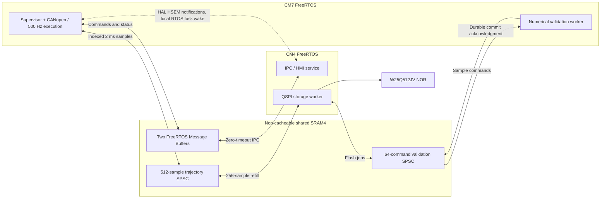

# Inter-core communication boundary

This module defines a **nonblocking, fixed-size M7/M4 IPC contract**. It does
not pretend that the existing single-RTOS POSIX simulator is already dual-core.

## Ownership
- M4-to-M7: only the M4 IPC service task writes; only M7 Supervisor reads.
- M7-to-M4: only M7 Supervisor writes; only the M4 IPC service task reads.
- Other M4 tasks send to their M4 IPC service through local FreeRTOS queues.
- The Supervisor has an optional GpIpcShared pointer. NULL preserves
  the current SIL Kit/single-core runtime.
- M7 consumes bounded HMI commands with monotonic sequence rejection and
  publishes a small status packet (state, motion permission, active fault,
  transitions, estop, most recently received command sequence, rejections).
- IPC receipt sequence is **not** confirmation that a command was accepted.
  Status may be dropped when the status ring is full.
- Existing taskENTER_CRITICAL() blocks are exclusively for same-scheduler
  snapshots. M4 must never call those APIs or receive their pointers.
- No pointer, task handle, callback, mutex or FreeRTOS queue goes across cores.
- Future flash operations use typed request/result messages; they are NOT yet
  connected to the current host flash worker.
- The mailbox is not a physical emergency-stop mechanism.

## Transport
- Host-only simulation uses two fixed-size SPSC rings, 16 entries per
  direction, with 60-byte application messages.
- **STM32H745 firmware uses a different, FreeRTOS-native backend:**
  `ipc_mailbox_freertos.c`, backed by two statically allocated FreeRTOS
  Message Buffers in shared SRAM4. It uses the **actual pinned** 10.6.2
  `message_buffer.h`, `stream_buffer.h` and `stream_buffer.c`; the
  nonstandard application flag `configUSE_STREAM_BUFFERS` is not needed.
- **Official implementation reference:** ST's
  [STM32H745I-DISCO FreeRTOS_AMP_Dual_RTOS](https://github.com/STMicroelectronics/STM32CubeH7/tree/master/Projects/STM32H745I-DISCO/Applications/FreeRTOS/FreeRTOS_AMP_Dual_RTOS).
  It creates shared buffers on M7 **before** the HSEM-0 boot release;
  M4 validates them on wake. Its `sbSEND_COMPLETED` hook, EXTI0 SW
  interrupt and `xMessageBufferSendCompletedFromISR` implement
  notification to the receiving kernel.
- **Production EXTI adapter (Stage 2E-4: ARM and both
  CubeIDE firmware builds PASS, 2026-10-12):**
  `Firmware/STM32H745/Common/Src/intercore_notifications.c` adapts
  ST's HAL EXTI SW-interrupt/FreeRTOS completion pattern for both
  directions. The ARM cross-compile/startup-order test passed for
  CM7/CM4, and both corresponding STM32CubeIDE builds reported
  0 errors and 0 warnings. Per-core ELF symbol inspection and
  physical two-core operation remain unverified. It reuses the backend's **successful zero-timeout send**
  notifier instead of ST's separate control Message Buffer and
  `sbSEND_COMPLETED` hook. EXTI0 carries M7→M4, EXTI1 carries
  M4→M7; each receiving ISR calls the FreeRTOS
  `xMessageBufferSendCompletedFromISR` helper only if that core's
  scheduler is running. Both CubeIDE projects inherit `DUAL_CORE` from the STM32H745
  CMSIS device header for C2 interrupt-register handling; they must
  **not** redundantly define the same macro through `-D` flags.
  GPIO EXTI0/1 are reserved for IPC on the production pin map.
- This adapter is **not a blocking bidirectional FreeRTOS transport**.
  IPC sends and receives remain strictly nonblocking, and no IPC
  consumer task is registered to wait for an interrupt yet. EXTI events
  may coalesce, so consuming tasks must drain queues. Physical delivery,
  missing-interrupt handling, latency and independent-core reset
  recovery remain unverified. The older HSEM 24–27 adapter/mock tests
  are separate exploratory code, not linked into this firmware.
- Initialize shared objects exactly once, with both cores quiescent.
  Never reset a live mailbox. Handle full queues and stale messages at
  the application layer. This is not a physical safety mechanism.

See the [verified Stage 1 STM32H745 firmware record](../Firmware/STAGE1_DUAL_CORE_FOUNDATION.md) for the source-backed CubeMX settings and dual-image build evidence.

## STM32H745 integration gate
- Allocate GpIpcShared in SRAM visible to both CPUs via BOTH linker scripts.
- Configure Cortex-M7 MPU mapping as **non-cacheable**, and confirm physical
  alignment, memory barriers, ownership, and boot-time handshake (HSEM).
- Verify ABI version, GPIO safety paths, reset/fault/recovery behavior and
  deadlines on hardware. Atomics alone do not provide cache coherence.
- Do not put mailbox in cached AXI SRAM without correct cache maintenance.

## Tests
- ipc_mailbox_test: four native threads, full/empty/backpressure, invalid
  messages, 100000 ordered messages in each direction.
- supervisor_interface_test: optional IPC HMI command routed to Supervisor,
  replay ignored, status publication checked while in E-stop.
- supervisor_silkit_sequence: must remain passing with optional IPC unused.
- Host tests are not STM32 memory-map, MPU/cache, timing or safety tests.

## Trajectory streaming (Issue 3: M4 flash -> M7 motion)

Files:
- `trajectory_stream.{h,c}`: NEW, separate cross-core path. Does not replace
  the legacy single-core `Simulation/Storage/trajectory_prefetch.{h,c}`.
- `trajectory_stream_path_port.{h,c}`: M7-only callbacks matching the
  `PathExecutionServices` stream signatures. A target composition root
  must connect these callbacks and consistently adapt the other services
  sharing the same `PathExecutionServices.context`.
- `Tests/test_trajectory_stream.c`: concurrency, generation, cancellation,
  flash-error, starvation, replay, and six-axis consistency checks.
- `Tests/test_trajectory_stream_path_port.c`: verifies the execution
  callback surface consumes exactly the samples produced by M4.

### Ownership and lifecycle

Only `GpTrajectoryShared` lives in shared SRAM (12,288 bytes of sample
data, plus a small header). M4 owns the `GpTrajectoryProducer` descriptor,
private 256-sample staging buffer (6,144 bytes), and flash read callback.
M7 owns the `GpTrajectoryConsumer` descriptor and 500 Hz execution.

1. M7 and M4 boot with a hardware handshake; initialize the shared region
   exactly once with both cores quiescent.
2. M4 validates a committed trajectory's identity (program ID, revision,
   artifact CRC, count, 2 ms period), then calls `gp_traj_m4_prepare`.
   **Identity equality is not a replacement for verifying flash contents
   against the committed artifact CRC.** That belongs to the M4 storage layer.
3. M4 calls `gp_traj_m4_step` as the sole producer. Each call reads at most
   256 samples from storage into private staging; it publishes complete
   six-joint samples to non-cacheable shared SRAM.
4. M7 starts only after `min(sample_count,512)` samples are published, with
   `gp_traj_m7_begin`, then consumes one indexed sample every 2 ms.
   M7 never calls a flash read or waits on a mutex/HSEM.
5. STARVED or STORAGE_ERROR is an immediate failure, not a valid position.
   The path-execution state must disable wire feed and issue its existing
   controlled-stop/fault response. This is not certified machine safety.
6. Once motion has ceased reading, M7 calls `gp_traj_m7_finish` (or
   `gp_traj_m7_discard` before starting). M4 acknowledges the epoch only
   after any in-flight read returned. M4 cannot reset/reuse the buffer
   before that acknowledgement.
7. Replaying the same validated path still requires a new epoch and M4
   re-prefill; it must not reuse previously consumed slots.

The shared ring is an SPSC protocol. `__atomic` acquire/release operations
order buffer publication on coherent / explicitly non-cacheable memory; they
are **not** a substitute for MPU configuration. Do not place the sample
ring in cached M7 SRAM without a designed cache-maintenance protocol.

### Boundaries not yet implemented

- Linking the existing IPC and trajectory modules into the now-generated,
  independently buildable CM7/CM4 firmware images; M4 QSPI driver ownership,
  actual shared-SRAM linker placement, M7 MPU non-cacheable region and
  application-level M7/M4 IPC startup handshake. The ST-generated boot
  scaffold is present but not hardware-validated.
- Production integration with the current SIL Kit `validated_prefetch`;
  intentionally kept unchanged to protect existing regression behavior.
- Hardware timing, cache, reset/recovery, DMA consistency and bus contention.
- Full storage RPC orchestration and durable-commit migration (Issue 4).
- Demonstrating a 500 Hz hard deadline on physical STM32 hardware (Issue 5).

### Host verification

After regenerating CMake, build `intercore_trajectory_stream_test` and
`intercore_trajectory_path_port_test`. Their passing results only show
protocol correctness under the tested host thread schedules. Re-run the
original `supervisor_silkit_sequence`, `trajectory_prefetch_concurrent_test`,
`path_execution_prefetch_test`, and `flash_prefetch_500hz_test` before
replacing any real control path.

## Asynchronous validation storage (Issue 4)

The flash-backed host path now models **three independent responsibilities**:
- M7 Supervisor (priority 4): 1 kHz state machine, safety decisions only.
- M7 numerical validator (priority 1): IK, trajectory generation, checks,
  quantization and CRC. Its storage adapter never calls QSPI.
- M4-role flash task (priority 1 in the POSIX model): transaction begin,
  sequential sample program, durable commit/recovery and abort. Its backend
  callbacks are the only operations allowed to touch NOR storage.

Implementation: `validation_storage_bridge.{h,c}`.
A 64-element SPSC queue (32 bytes per slot) lives in shared SRAM alongside a
commit metadata snapshot. M7 publishes complete sample commands; M4 consumes
them in order. The **storage callbacks are NOT shared**: only M4's private
worker descriptor holds the actual flash driver function pointers.

The validator's optional `try_write_sample` and `try_commit` callbacks
return ACCEPTED / BUSY / FAILED. When BUSY, it retains the generated sample
and does not call the stateful ControlCore stream generator again. A queued
COMMIT returns BUSY until M4 has completed the actual backend commit; only
then may Supervisor receive VALID. Flash failure causes abort/reject, never
"VALID because the data was queued."

Cancellation sets a nonblocking request; M4 owns backend.abort and does not
acknowledge while an erase/program/read callback is in flight. The next
validation is gated by `gp_validation_m4_idle()`, which requires queue drain,
released/aborted flash transaction, and acknowledged cancellation.

**Compatibility:** Legacy RAM storage and existing single-core prefetch
are preserved. Host `GP_STORAGE_BACKEND=flash` now uses the new bridge;
the SIL Kit hardware model still runs on one POSIX FreeRTOS scheduler.
This is functional separation, **not** a deployed pair of STM32 firmware
images and not a proven 1 ms worst-case timing result.

**Important hardware constraints:** Both cores must use non-cacheable
shared SRAM and a defined MPU/HSEM boot handshake. The storage metadata
`ValidatedTrajectory` must have the same ABI/layout in both firmware
builds. Cache coherence, linker placement, physical QSPI ownership,
power-failure durability, fault/abort recovery and worst-case deadlines
must be verified separately on the STM32H745. A committed NOR record may
not be reversible if cancellation races with an already durable commit;
authorization to execute must remain with Supervisor and must check the
expected validated artifact identity.

Host regressions:
- `intercore_validation_storage_test` checks bounded queue backpressure,
  no premature commit, sequential reads, flash write failure and cancellation
  of an in-flight flash callback.
- `path_validation_test` now also runs the real numerical validator over
  the async adapter; compares stored sample/metadata CRC against synchronous
  output and checks BUSY/retry and durable-commit gating.
- `supervisor_silkit_flash_sequence`,
  `supervisor_silkit_flash_cancel`, and
  `supervisor_silkit_flash_program_fail` exercise the flash-backed whole
  simulator when built on the host.

## STM32H745 target backend (FreeRTOS Message Buffers + HSEM)

This is a **target-only, not-yet-hardware-verified implementation**, added
without modifying the tested SIL Kit/POSIX transport. There are no STM32 dual
firmware images in this repository yet, so **nothing here establishes STM32
compile success, interrupt correctness, or 500 Hz execution guarantees**.

### Technology decision

| Layer | Decision | Reason |
| --- | --- | --- |
| HMI / status / small diagnostics | `ipc_mailbox_freertos.c`: real FreeRTOS static Message Buffers, one each direction | Standard message framing, bounded nonblocking messages, no new custom ring |
| Trajectory streaming | Keep `trajectory_stream.c` dedicated 512 x 24-byte SPSC buffer | Avoid additional copies/variable message overhead in 2 ms consumption |
| NOR validation writes | Keep `validation_storage_bridge.c` 64 x 32-byte SPSC command queue | Durable commit, M4 backend ownership, BUSY, ordered writes and cancel/ack are application transaction semantics |
| Remote notifications | `ipc_stm32h745_hsem.c` via STM32 HAL HSEM | Hardware signaling; not a cross-core FreeRTOS queue |
| OpenAMP/RPMsg | Do not add | Unnecessary protocol/metadata/runtime cost for two fixed roles and short messages |

### Compile and integration contract

1. Compile `Intercore/ipc_mailbox_freertos.c` **instead** of
   `Intercore/ipc_mailbox.c` into each STM32 target. Define
   `GP_IPC_FREERTOS_BACKEND=1` for all application translation units using
   `GpIpcShared`. Do not define it for POSIX host targets.
2. Pin and use identical FreeRTOS kernel revision/ABI, compiler C data layout,
   FreeRTOSConfig settings and `StaticMessageBuffer_t` layout on both cores.
   `configSUPPORT_STATIC_ALLOCATION=1` and `configUSE_STREAM_BUFFERS=1` are
   required. The existing **host** `FreeRTOSConfig.h` has static allocation
   disabled and must not simply be reused as the final target configuration.
3. Allocate **one** `GpIpcShared` in D3 SRAM at 0x38000000 (64 KiB total
   SRAM4), in an identically mapped `.shared_ram (NOLOAD)` section in both
   linker files. Other shared regions (trajectory samples and validation
   queue) need their own bounded allocation; check total SRAM4 usage and any
   DMA restrictions. Configure the CM7 MPU for noncacheable shareable SRAM4
   and validate MPU rules before enabling D-cache. The global structure must
   be 32-byte aligned and never initialized independently by M4.
4. M7, with M4 quiescent, initializes shared regions and calls
   `gp_ipc_initialize` ONCE. After publication of the magic/ABI and a
   documented HSEM boot handshake, release M4. Both cores check
   `gp_ipc_valid` before any send/receive. Reset of either core invalidates
   session ownership: stop control, quiesce both IPC users, and re-bootstrap;
   never silently resume an old buffer/trajectory epoch.
5. Compile `ipc_stm32h745_hsem.c` in each core image, with exactly one
   `GP_IPC_CORE_M7` or `GP_IPC_CORE_M4`. Call
   `gp_ipc_stm32_hsem_setup(local_service_task)` per core after HAL clock/
   RTOS setup. In the board's single `HAL_HSEM_FreeCallback(uint32_t mask)`
   call `gp_ipc_stm32_hsem_on_free(mask)`. Enable `HSEM1_IRQn` on M7 or
   `HSEM2_IRQn` on M4, with an ISR priority compatible with FreeRTOS
   `...FromISR` calls. Call `HAL_HSEM_IRQHandler()` from the IRQ handler.
   Reserve HSEM IDs 24..27 for IPC, keeping HSEM 0 available for ST's boot handshake (see enum); do not share them with other
   boot/IPC code. Do not overwrite existing HAL callbacks blindly.
6. These operations use **zero timeout**. No sender or receiver is permitted
   to block on the shared message buffer because that can install a foreign
   FreeRTOS task handle in the shared control block and cause cross-kernel
   task-notification corruption. HSEM wakes only a **local** service task via
   its private task handle. M7 Supervisor always polls/drains a bounded number
   of messages; M4 service must recheck messages with a bounded fallback poll
   because HSEM notifications can coalesce/fail. Check send return values;
   full means dropped/explicit backpressure, never overwrite.
7. Only one M4 IPC service task writes M4-to-M7 and reads M7-to-M4; only the
   M7 Supervisor does the opposite. Other M4 producers use *local* FreeRTOS
   queues to reach the service task. M7 must never wait for M4, HSEM, NOR,
   erase, program, or readback. The nonblocking HAL `FastTake` path should be
   measured before motion deployment. This transport is not the E-stop path.

### Architecture



### Verification status and target gates

- Existing host builds and tests continue using `ipc_mailbox.c`; their
  behavior is untouched. This is **compatibility**, not target verification.
- Target source is not included in host `CMakeLists.txt` because the STM32
  CM7/CM4 target configurations and HAL dependencies are not present.
- Required before enabling on a robot: separate CM7/CM4 cross-compilation,
  linker-map / MPU checks, shared FreeRTOS struct layout and version checks,
  HSEM callback and priority integration, notification coalescing/full-buffer
  tests, core reset/fault injection, NOR cancel/commit tests, and physical
  measurement of 500 Hz jitter and worst-case IPC latencies. No such outcomes
  are claimed here.

Upstream foundations: [ST AN5617](https://www.st.com/resource/en/application_note/an5617-introduction-to-interprocessor-communications-for-stm32h745755-and-stm32h747757-mcus-stmicroelectronics.pdf),
[STM32CubeH7 AMP Dual RTOS reference](https://github.com/STMicroelectronics/STM32CubeH7),
[ST's FreeRTOS message-buffer/HSEM guide](https://community.st.com/stm32-mcus-60/how-to-use-freertos-message-buffers-on-stm32h7-dual-core-devices-23),
and [FreeRTOS Message Buffers](https://www.freertos.org/).
No ST or FreeRTOS source is copied into this repository; these adapters call
upstream APIs and are project-owned. Their runtime behavior depends on the
FreeRTOS version selected when the MCU project is created. STM32CubeH7's
software license and FreeRTOS's MIT licensing apply to the eventual vendored
components, not to separately authored glue code.

### Repeatable cross-compile test (WSL)

Run `bash Intercore/Tests/test_ipc_freertos_compile.sh` from any working
directory. Or, after configuring CMake, run
`ctest --test-dir build-can-silkit -R '^intercore_ipc_arm_compile_test$' --output-on-failure`.
The test uses the installed `../FreeRTOS-Kernel`, or `FREERTOS_KERNEL_ROOT`
when explicitly set. It verifies that the STM32-only FreeRTOS IPC backend
compiles for both **Cortex-M7** and **Cortex-M4**, with warnings as errors.

The repository's existing `FreeRTOSConfig.h` is a POSIX host configuration
and intentionally has no ARM interrupt-priority definitions. The script
creates a temporary modified copy with static allocation, four implemented
NVIC priority bits, and test-only interrupt priorities (15 lowest / 5 max
syscall). This corrects the expected ARM port header failure
(`configMAX_SYSCALL_INTERRUPT_PRIORITY` undeclared) without silently
modifying the production or host configuration. These placeholder values
must be explicitly rechecked against STM32H745 and target FreeRTOS settings
when creating the two firmware projects. The temporary file is deleted.

This test does **not** link or run FreeRTOS, validate a target linker script,
test HSEM interrupt/callback code, place the mailbox in shared SRAM, check
cache behavior, or demonstrate physical timing correctness. Run the existing
`ipc_mailbox_test` and other regressions separately for the host transport.

### FreeRTOS IPC POSIX runtime test

The permanent integration test is
`Intercore/Tests/test_ipc_freertos_runtime.c`, built by
`Intercore/Tests/run_ipc_freertos_runtime.sh` (or CTest
`intercore_ipc_freertos_runtime_test`). Its separate CMake project,
`Intercore/Tests/ipc_freertos_runtime/`, builds the locally installed,
**actual FreeRTOS-Kernel GCC_POSIX port and stream-buffer implementation**.
It does not modify or relink the existing SIL Kit host kernel, which has static
allocation disabled.

```bash
bash Intercore/Tests/run_ipc_freertos_runtime.sh
# After re-running top-level cmake configure:
ctest --test-dir build-can-silkit -R '^intercore_ipc_freertos_runtime_test$' --output-on-failure
```

Covers empty/invalid messages, bidirectional payload framing, exact 16-message
capacity, non-overwrite backpressure, ordered delivery, duplicated sequences,
successful-send/receive notification callbacks, and two producer / two consumer
FreeRTOS tasks transmitting 2000 messages in each direction.

Only the test compile defines `GP_IPC_POSIX_TEST=1` to allow 64-bit
host-sized pointers and `size_t`; the original 32-bit ABI assertions remain
mandatory for real STM32 images. A test-specific FreeRTOS configuration enables
static allocation and supplies idle-task static memory, while inheriting the
main project's host settings.

**Limitations:** The POSIX port runs on one FreeRTOS scheduler, so its tasks
interleave rather than execute simultaneously on two independent STM32 cores.
Notifications tested here are project callback invocation, **not HSEM IRQ
delivery**. The test cannot prove shared SRAM cache coherence, core reset
behavior, HAL integration, or physical 500 Hz determinism.

### STM32 HSEM adapter mock tests

`bash Intercore/Tests/run_ipc_hsem_mock.sh` executes the actual
`ipc_stm32h745_hsem.c` with small HAL/FreeRTOS test doubles and compiles
**both** `GP_IPC_CORE_M7` and `GP_IPC_CORE_M4` configurations.
CTest name: `intercore_ipc_hsem_mock_test`.

The test checks HSEM clock/notification configuration, all four
notification IDs, correct per-core incoming masks, successful nonblocking
take/release, failed FastTake counter with no release, irrelevant IRQ masks,
local task notification and ISR yield, and null task behavior.

This is **logic verification against mocks**, not proof of actual STM32 HAL
header compatibility, HSEM IRQ dispatch, interrupt priority correctness,
cross-core timing, missed IRQ recovery, or hardware coherency.

### HSEM adapter tests: STM32CubeH7 HAL wiring (mock peripheral)

Run `bash Intercore/Tests/run_ipc_hsem_mock.sh` or the CTest case
`intercore_ipc_hsem_mock_test`. The adapter is compiled separately with
`GP_IPC_CORE_M7` and `GP_IPC_CORE_M4`, the **real installed FreeRTOS
POSIX headers** and HAL-only test doubles. Tests cover the exact receiving
core masks, 24..27 semaphore-ID mapping, one-shot rearm, failure counters,
no release on a failed take, IRQ notification and yield, and NULL task.

**Reservation constraint:** The STM32CubeH7 H745 dual-core startup examples
use HSEM ID 0 for releasing CM4. The IPC event enum values 0..3 are logical
notification types, **not physical HSEM IDs**. The adapter now reserves
HSEM IDs 24..27. Both STM32 firmware images must reserve these four IDs
exclusively and check against all future boot/RTOS/driver semaphore uses.
The unit test does not run ST HAL or hardware interrupts; target CubeH7
header integration, NVIC priority, MPU and real inter-core wake-up remain.

### Official STM32CubeH7 HAL compilation (no hardware)

`bash Intercore/Tests/test_ipc_stm32_hal_compile.sh` checks **both**
`GP_IPC_CORE_M7` and `GP_IPC_CORE_M4` using the real ST HAL headers, the
actual `stm32h7xx_hal_hsem.c` implementation, CMSIS, and the installed
FreeRTOS ARM ports. Set `STM32CUBEH7_ROOT` to a complete STM32CubeH7 SDK
checkout if it is not available at `../STM32CubeH7`.

The recommended source is the official
[STM32CubeH7 package](https://github.com/STMicroelectronics/STM32CubeH7)
with its CMSIS device and HAL driver **Git submodules populated**.
The compiler uses ST's `STM32H745I-DISCO/Examples/HSEM/HSEM_CoreNotification`
example configuration for each core. ST SDK content remains outside the
robot-control repository. Do not mix independently downloaded HAL and
CMSIS versions.

CMake/CTest can register the opt-in test when configured with
`-DGP_STM32CUBEH7_ROOT=/absolute/path/to/STM32CubeH7`; its CTest name is
`intercore_ipc_real_hal_compile_test`. The standalone script checks for
missing SDK dependencies and exits nonzero, never reporting a false pass.

The gate proves compilation of the HSEM adapter against **official**
STM32CubeH7 API declarations and compilation of ST's corresponding HSEM
source, not linking or execution of a complete two-core firmware image.
It does not verify linker scripts, actual HAL IRQ dispatch, NVIC settings,
MPU/cache configuration, HSEM wakeup timing, reset/recovery, or 500 Hz jitter.
Actual firmware must use separately generated validated CM7/CM4 FreeRTOS
configs rather than the temporary test configuration.
